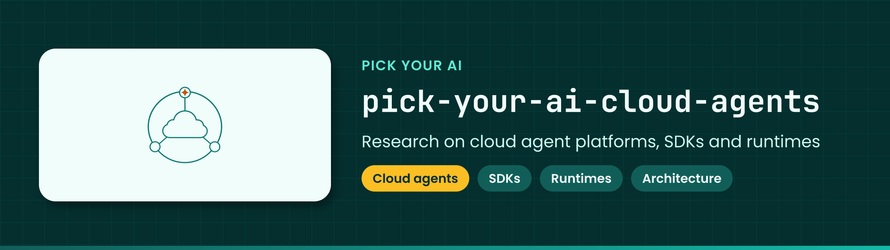

<!-- showcase:banner:start -->

  

<!-- showcase:banner:end -->

<!-- showcase:nav:start -->
**Pick Your AI** · [All repositories](https://github.com/Pick-Your-AI) · [Contributing](CONTRIBUTING.md) · [Security](https://github.com/Pick-Your-AI/.github/blob/main/SECURITY.md)
<!-- showcase:nav:end -->

# Pick Your AI — Cloud Agents

<!-- showcase:badges:start -->

<!-- showcase:badges:end -->

<!-- showcase:tagline:start -->
**Research home for cloud agent platforms, SDKs, runtimes and architecture across AWS, OpenAI, Anthropic and other providers. Initial organizational setup only.**
<!-- showcase:tagline:end -->

---

## About

Research and planning for cloud agent platforms, SDKs, runtimes, and architecture across AWS, OpenAI, Anthropic, and other providers.

This repository is initialized for collaboration. Implementation, provider evaluations, and the delivery backlog have not started.

## Notes

### Organization

- [Cloud Agents team](https://github.com/orgs/Pick-Your-AI/teams/cloud-agents)
- [Lead Maintainers — Cloud Agents](https://github.com/orgs/Pick-Your-AI/teams/lead-maintainers-cloud-agents)
- [Project #12](https://github.com/orgs/Pick-Your-AI/projects/12)
- Initial delegated team maintainer: [@oxfern](https://github.com/oxfern). Live GitHub membership and issue assignments are authoritative.

### Scope

Future work may cover agent frameworks, managed runtimes, orchestration, tools and integrations, memory, deployment architecture, and provider-specific constraints. Record evidence and limitations before presenting a capability as supported.

Existing research remains in [pick-your-ai-research](https://github.com/Pick-Your-AI/pick-your-ai-research), including [T4: Agents & Integrations](https://github.com/Pick-Your-AI/pick-your-ai-research/issues/24) and [the coverage and routing audit](https://github.com/Pick-Your-AI/pick-your-ai-research/issues/509). Coordinate with those owners; do not duplicate or relocate accepted findings without agreement.

Read [CONTRIBUTING.md](CONTRIBUTING.md) before proposing work.
